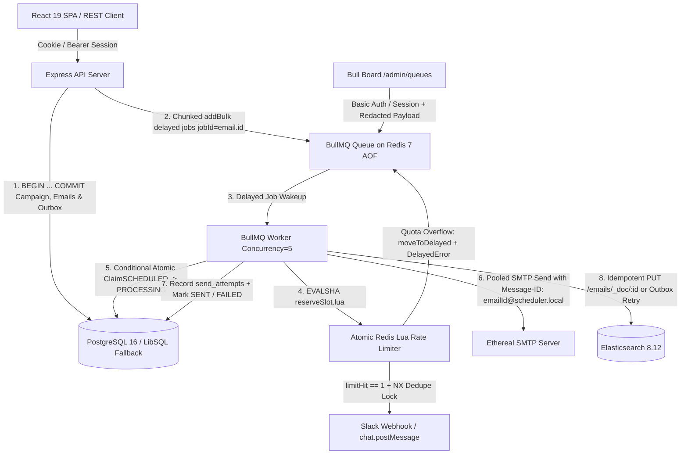

# Architecture Reference & Delivery Guarantees

## 1. System Topology



---

## 2. Durable Scheduling & Transactional Outbox (Zero Cron)

1. **No Cron of Any Kind**: There are zero `crontab`, `node-cron`, or polling schedulers in the codebase. Every scheduled email is dispatched via a BullMQ delayed job (`delay = max(0, startAtMs - Date.now())`) with deterministic `jobId = email.id`.
2. **Solving the DB / Redis Dual-Write Problem**:
   - In `scheduleCampaign()` (`src/services/scheduler.ts`), inserting the `campaigns` record, batch-inserting the `emails` records (`status = 'SCHEDULED'`), and inserting a `CAMPAIGN_ENQUEUE` record into `outbox_jobs` (`status = 'PENDING'`) execute inside a single atomic database transaction (`db.withTransaction()`).
   - After the transaction commits, the API enqueues the BullMQ jobs in chunks of `ENQUEUE_CHUNK_SIZE` (`500`) and marks the `outbox_jobs` row `PROCESSED`.
   - If the process crashes immediately after the DB commit before Redis enqueue completes, `reconcile()` (`src/services/reconcile.ts`) scans `outbox_jobs WHERE status IN ('PENDING', 'FAILED')` and any `SCHEDULED` emails missing from BullMQ, re-enqueuing them idempotently (`jobId = email.id`).

---

## 3. Atomic Multi-Worker Rate Limiting (`reserveSlot.lua`)

- **Why Application-Memory Rate Limiters Fail**: In a multi-worker deployment (`WORKER_CONCURRENCY = 5` across one or more Node processes), checking `SELECT COUNT(*)` or keeping counters in JavaScript memory causes time-of-check-to-time-of-use (TOCTOU) race conditions.
- **Single-Roundtrip Redis Lua Execution**:
  - `src/redis-scripts/reserveSlot.lua` runs atomically inside Redis using `EVALSHA` (with automatic `NOSCRIPT` reload).
  - Keys:
    - `slot:{<senderId>}`: Last reserved send timestamp (ms) for that sender.
    - `rl:{<senderId>}:<windowIndex>`: Reserved send count for the 1-hour UTC window `floor(ts / 3600000)`.
  - Guarantees:
    1. **Minimum Spacing (`minDelayMs`)**: Each reserved timestamp is at least `lastSlot + minDelayMs` (default `2000ms`).
    2. **Hourly Ceiling (`hourlyLimit`)**: If `rl:{senderId}:{windowIndex} >= hourlyLimit`, the script advances `candidate` to the start of the next UTC hour window `(windowIndex + 1) * 3600000` and checks up to `RATE_LIMIT_LOOKAHEAD_WINDOWS` (default `72` hours) relative to `baseWindow = floor(now / 3600000)`.
    3. **Zero-Drop Overflow Rescheduling**: Jobs are never dropped when a quota is full. If the reserved `slotTs > now`, the worker persists `status = 'RESCHEDULED'` (when `limitHit == 1`), updates `job.updateData({ emailId, slotAt: slotTs })`, moves the job back to BullMQ's delayed set via `job.moveToDelayed(slotTs, token)`, and throws `DelayedError`.

---

## 4. Honest SMTP Delivery Guarantee & Crash Recovery Semantics

### Why Strictly "Exactly-Once" SMTP Delivery Is Impossible Over Standard SMTP
Standard SMTP (`RFC 5321`) does not support distributed two-phase commit (`2PC`) with an application database. A worker process can crash or lose power in the sub-millisecond window **after** the remote SMTP server writes `250 2.0.0 OK` to the TCP socket, but **before** the worker's `UPDATE emails SET status = 'SENT'` transaction commits in PostgreSQL.

### How ReachInbox Minimizes Duplicate-Send Risk
1. **Pre-Send Atomic Claim Guard**:
   ```sql
   UPDATE emails
   SET status = 'PROCESSING', processingStartedAt = ?, attempts = attempts + 1, updatedAt = ?
   WHERE id = ?
     AND (
       status IN ('SCHEDULED', 'RESCHEDULED')
       OR (status = 'PROCESSING' AND processingStartedAt < ?)
     )
   ```
   If two workers concurrently pick up the same `emailId`, only one wins `rowsAffected = 1`; the second receives `rowsAffected = 0` and exits immediately without touching SMTP.
2. **Deterministic RFC 5322 `Message-ID`**:
   Every email is transmitted with `Message-ID: <${email.id}@scheduler.local>`. If a worker crashes in the post-SMTP pre-DB-commit window and `reconcile()` reclaims the stale `PROCESSING` claim after `STALE_CLAIM_MS` (default `120,000ms`), the retried transmission carries the identical `Message-ID` so downstream MTAs can deduplicate it.
3. **Graceful Shutdown Claim Release**:
   On `SIGTERM` / `SIGINT`, the server stops accepting new HTTP requests, calls `stopEmailWorker()` to let in-flight jobs finish within the drain window, and releases any remaining unfinished `PROCESSING` claims back to `SCHEDULED` before closing Redis and PostgreSQL connections.
4. **SMTP Acceptance vs. Inbox Placement**:
   `status = 'SENT'` indicates that the remote SMTP server (Ethereal) returned a `250 OK` acceptance response and `messageId` (recorded in `send_attempts`), not that a human recipient opened the message.

---

## 5. Elasticsearch Indexing, Outbox Recovery & Observable Fallback

- **Deterministic Mapping & Document ID**: The `emails` index is created with explicit field mappings (`userId`: `keyword`, `campaignId`: `keyword`, `senderId`: `keyword`, `status`: `keyword`, `recipientEmail`: `text` + `.keyword`, `subject`: `text`, `body`: `text`, `scheduledAt`: `date`, `sentAt`: `date`) and indexed via `PUT /emails/_doc/${email.id}` (`op_type = index`), making repeated indexing idempotent.
- **Durable Outbox Retry**: If Elasticsearch is down when an email is scheduled, sent, failed, or cancelled, `indexEmailDocument()` records the error in `emails.esSyncError` and writes an `ELASTICSEARCH_INDEX` job into `outbox_jobs`. When Elasticsearch recovers, `reconcile()` or `POST /api/search/reindex` replays all pending/unindexed rows and clears `esSyncError`.
- **Observable Search Fallback**: When Elasticsearch is unavailable, `GET /api/search` executes a user-scoped SQL fallback query and explicitly returns `"source": "database_fallback"` and `"esHealthy": false` while `GET /ready` marks `components.elasticsearch.healthy = false`.

---

## 6. Authentication, Session Security & Multi-Tenant Isolation

- **Google OAuth 2.0 / OIDC**: Uses single-use state tokens stored in `oauth_states` (`purpose = 'google_oauth'`) + HMAC signature verification, exchanges authorization codes via Google's token endpoint, validates ID token claims (`iss`, `aud`, `exp`, `sub`, `email_verified`), and creates a database-backed session in `sessions`.
- **Session Lifecycle**: Sessions are transmitted via an `HttpOnly`, `SameSite=Lax` cookie (`reachinbox_session`) or `Authorization: Bearer <token>`. `POST /api/auth/logout` deletes the row from `sessions` and clears the cookie, immediately invalidating subsequent requests (`401 SESSION_EXPIRED`).
- **Strict Tenant Isolation**: Every campaign, email list, detail, attempt log, cancel, retry, search, reindex, and Slack endpoint filters by `WHERE userId = req.user.id`. Cross-tenant access attempts return `404 EMAIL_NOT_FOUND`.
